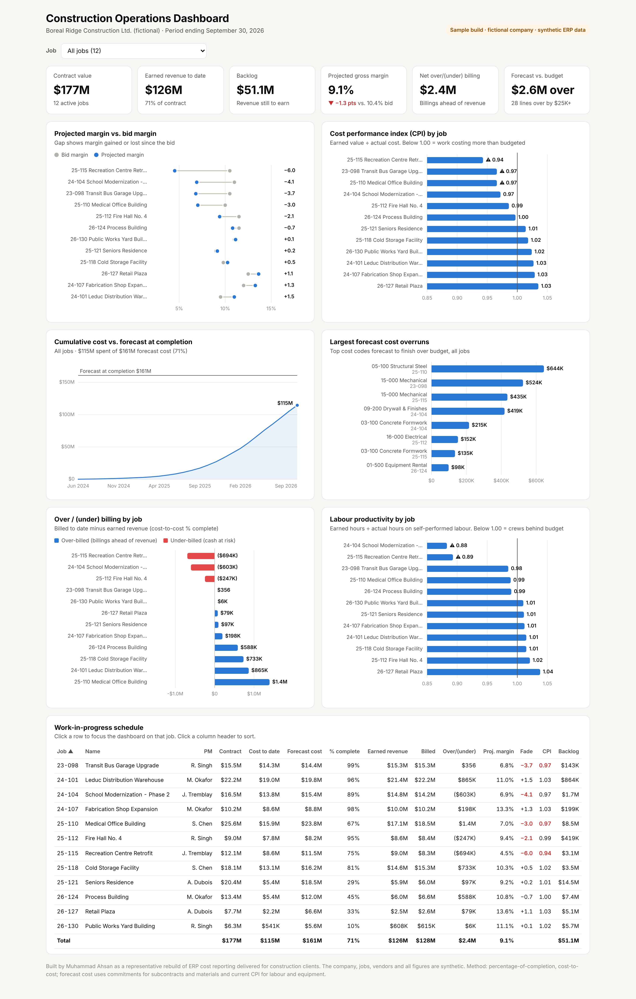
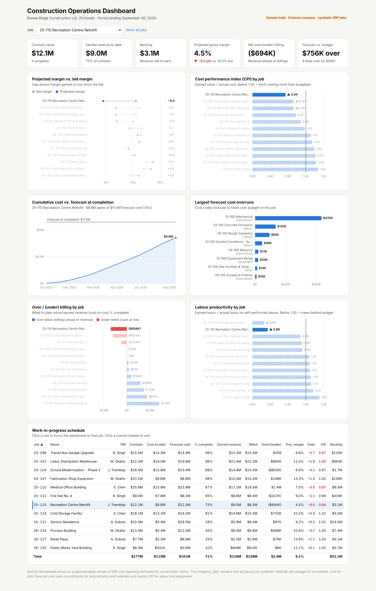

# ERP Job Cost Reporting & Operations Dashboard — Construction

**Turning a contractor's ERP job cost export into a monthly cost report, a WIP schedule and an operations dashboard that flag which jobs are losing margin and why.**

> **Sample build.** This is a representative rebuild of ERP cost reporting I delivered for construction-sector clients. Client data is confidential, so everything here runs on a **synthetic export for a fictional general contractor** (Boreal Ridge Construction Ltd.). The company, jobs, vendors and all figures are invented; the reporting logic is the real deliverable.

**Author:** Muhammad Ahsan · [LinkedIn](https://www.linkedin.com/in/ahsan1143) · **Tools:** SQL (SQLite), Excel (SUMIFS / INDEX-MATCH / data validation), HTML/JavaScript dashboard, Python for data prep



---

## The problem
Project managers see costs job by job in the ERP, but leadership needs one monthly view that answers:
- Which jobs are **losing margin** compared with the bid, and which cost codes are causing it?
- How much **revenue have we earned** (percentage-of-completion) versus what we've **billed**?
- What will each job **cost at completion**, and how much **backlog** is left?

## What's in this repo

| Deliverable | What it does |
|---|---|
| `excel/Job_Cost_Report_Sep2026.xlsx` | Monthly job cost report. **WIP Schedule** for all jobs, **Job Detail** page driven by a job drop-down, **Monthly Cost** trend with cost curve, and a **Cost Report** calculation tab. 3,700+ live formulas on the raw export tabs — paste next month's export in and it refreshes. |
| `dashboard/index.html` | Interactive operations dashboard: KPI tiles, margin fade vs. bid, CPI by job, cumulative cost vs. forecast, largest overruns, over/(under) billing, labour productivity and a sortable WIP table. Pick a job to focus every view on it. Single file, no install. |
| `sql/` | The same reporting logic in SQL: cost-code report view, WIP schedule, overrun list, monthly cost trend (window functions), labour productivity. |
| `data/` | The synthetic ERP export: job master, cost codes, budgets, PM progress, commitments (subcontracts/POs), 2,670 job cost transactions (AP, payroll, equipment), progress billings with 10% holdback. |

The Excel report and the SQL layer were built independently and **reconcile to the cent** on every job.

## Method
| Measure | Calculation |
|---|---|
| Earned value | Revised budget × PM-reported physical % complete (by cost code) |
| CPI | Earned value ÷ actual cost |
| Forecast cost at completion | Subcontracts & materials with a commitment: greater of committed value and cost to date. Labour, equipment and other lines in progress: cost to date + remaining budget ÷ CPI. Lines not started: revised budget. |
| % complete (revenue) | Cost-to-cost: cost to date ÷ forecast cost |
| Earned revenue | Revised contract × % complete |
| Over/(under) billing | Billed to date − earned revenue |
| Margin fade | Projected margin % − bid margin % |
| Labour productivity | Earned hours ÷ actual hours on self-performed labour |

## What the September 2026 report shows (sample data)

- **Portfolio:** 12 jobs, \$176.9M in contracts, \$114.6M spent, \$51.1M backlog.
- **Margin erosion:** projected gross margin is **9.1% vs. a 10.4% bid** — about **\$2.3M of profit lost** since bid. Four jobs have faded about 3 points or more: Recreation Centre Retrofit (−6.0 pts), School Modernization (−4.1), Transit Bus Garage (−3.7) and Medical Office Building (−3.0).
- **Root causes:** 28 cost lines are forecast \$25K+ over budget, \$3.6M in total. The largest are a **structural steel** subcontract (+\$644K), two **mechanical** subcontracts (+\$524K, +\$435K) and **drywall** (+\$419K). Self-performed **concrete formwork** crews on two jobs are running at 0.74–0.89 CPI.
- **Cash:** billings run \$2.4M ahead of earned revenue overall, but three jobs are **under-billed by \$1.5M** combined — revenue earned but not yet invoiced, including the two jobs with the largest margin fade.



## Repository structure
```
erp-job-cost-reporting/
├── excel/Job_Cost_Report_Sep2026.xlsx   # monthly cost report & WIP schedule
├── dashboard/
│   ├── index.html                       # the dashboard (open in any browser)
│   ├── template.html                    # dashboard source before data is inlined
│   └── dashboard_data.json
├── sql/                                 # 01 cost-code view, 02 WIP, 03 overruns, 04 trend, 05 productivity
├── data/                                # synthetic ERP export (CSV)
├── src/
│   ├── generate_sample_data.py          # creates the synthetic export (seeded)
│   ├── build_database.py                # loads the export into SQLite + reporting view
│   └── build_dashboard_data.py          # runs the SQL and builds the dashboard
└── reports/figures/                     # screenshots
```

## How to run
Open `excel/Job_Cost_Report_Sep2026.xlsx` in Excel, or open `dashboard/index.html` in a browser. To rebuild everything:
```bash
pip install pandas
python src/generate_sample_data.py
python src/build_dashboard_data.py
```
**Live dashboard:** enable GitHub Pages on this repository (Settings → Pages → Deploy from branch → `main` / root). The dashboard is then served at `https://<your-username>.github.io/erp-job-cost-reporting/dashboard/`.
